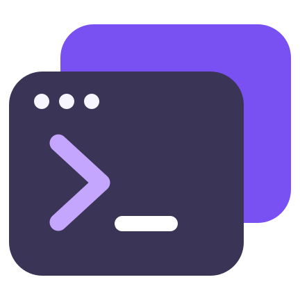
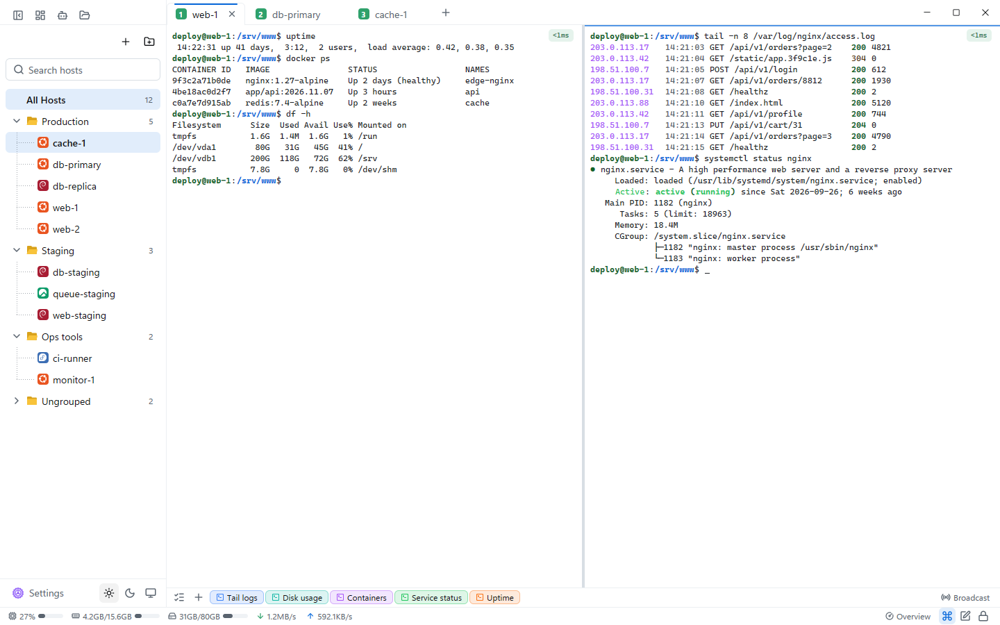
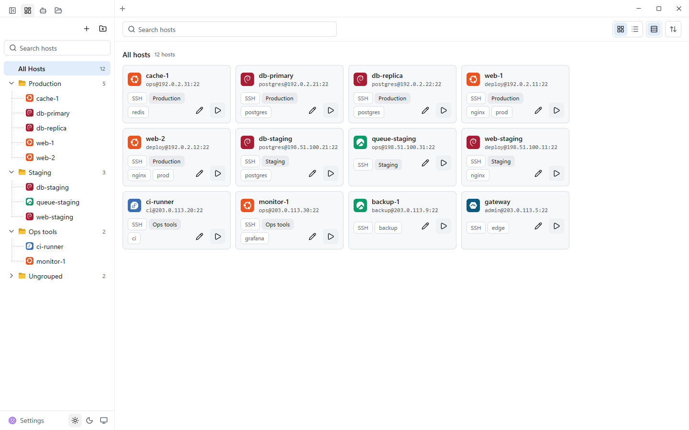
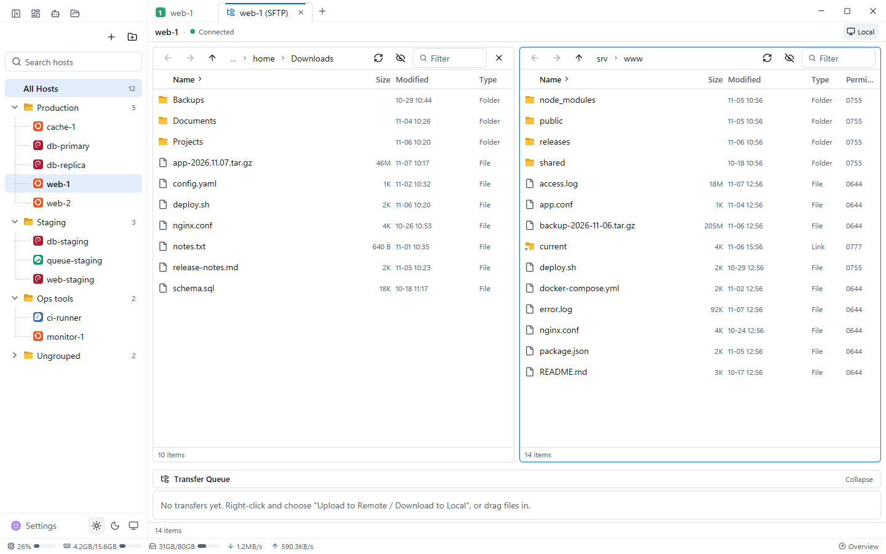
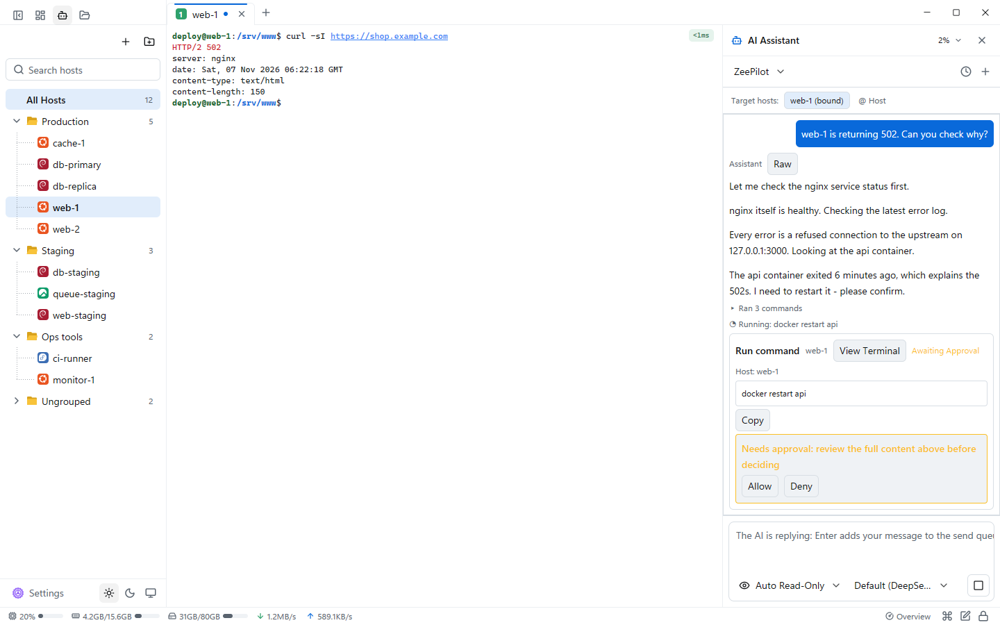
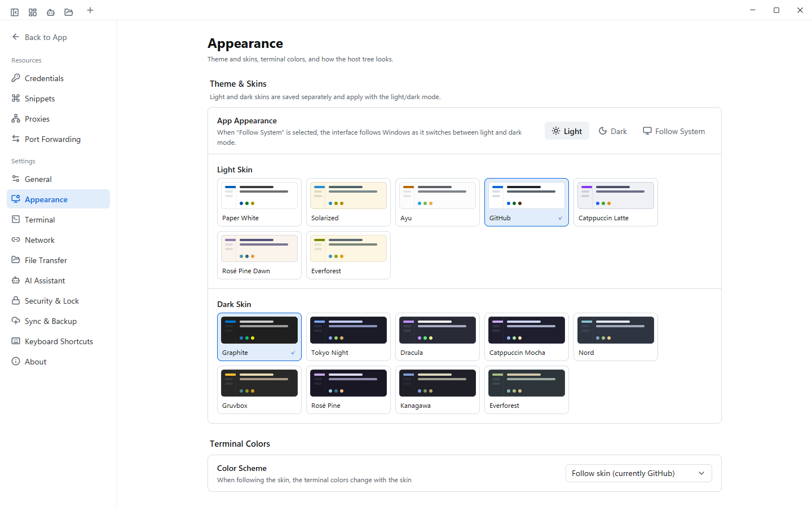
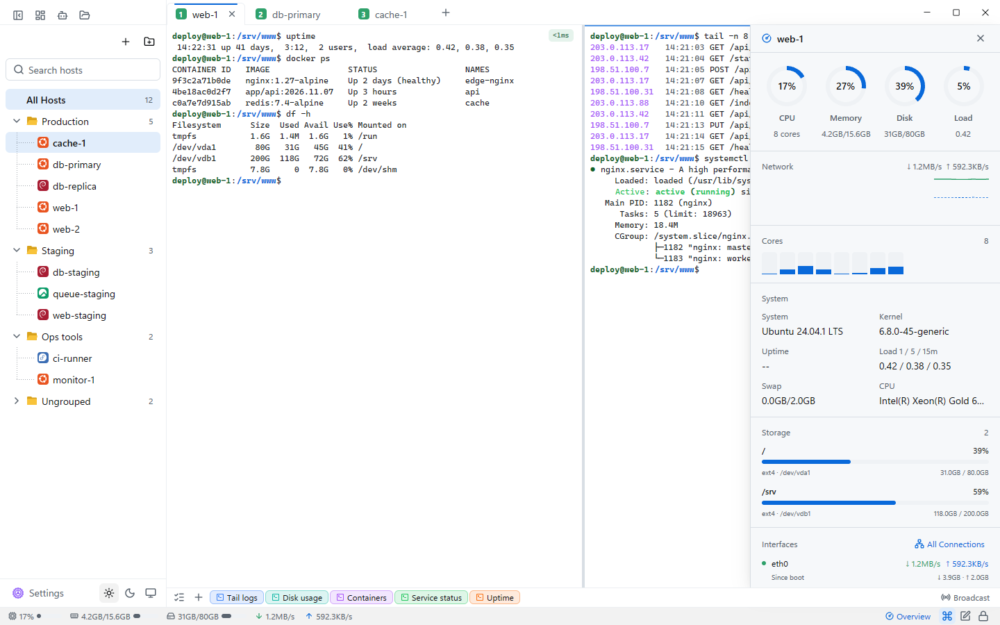
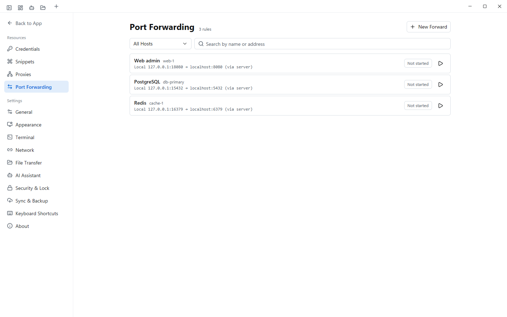

<p align="center">
  
</p>

<h1 align="center">ZeeTerm</h1>

<p align="center">
  <strong>A native SSH workspace. Built with Rust and GPUI.</strong><br />
  Terminals, file transfers, remote editing, and AI assistance in one desktop application.<br />
  Rendered natively with GPUI on the GPU: <strong>No Electron. No WebView2. No embedded browser.</strong>
</p>

<p align="center">
  
  
  
  
  
  <a href="LICENSE"></a>
</p>

<p align="center">
  <a href="https://github.com/MoeShinX/ZeeTerm/releases/latest"><strong>Download</strong></a> ·
  <a href="README.zh-CN.md">简体中文</a> ·
  <a href="https://t.me/ZeeTerm">Telegram</a> ·
  <a href="https://zeeterm.app/">Website</a> ·
  <a href="CHANGELOG.md">Changelog</a>
</p>

## ✨ Highlights

- **Bring your own AI agent.** ZeeTerm finds the **Claude Code, Codex or OpenCode** already installed on your computer and lets it work on your servers from a chat panel next to the terminal: it sees the session it is attached to and runs commands there under the approval mode you pick (ask for every command, run read-only commands automatically, or full access). No agent installed? The built-in **ZeePilot** works with any OpenAI-compatible or Anthropic endpoint.
- **Dual-pane file manager, Xftp style.** Local and remote folders side by side, docked right next to the terminal, in a tab of its own, or in a separate window. Drag files between the panes, follow the terminal's current directory, and keep a transfer queue with pause, resume and automatic reconnect.
- **Native, not a web page.** Written in Rust and drawn by GPUI on the GPU: no Electron, no WebView2, no embedded browser. It starts fast and stays light.
- **One workspace on Windows, Linux and macOS**, with end-to-end encrypted sync (WebDAV, S3, GitHub Gist or OneDrive) and up to five extra cloud backups.
- **Your secrets stay protected.** Saved passwords and keys are encrypted with the operating system's own facilities (DPAPI, Secret Service, macOS Keychain); an app lock covers the window while sessions keep running; updates are installed only after their signature is verified.

## ⚡ Rebuilt for native rendering

ZeeTerm is the **GPUI native rebuild of [Z-SSH](https://github.com/MoeShinX/Z-SSH)**. Its desktop interface and terminal rendering are implemented in Rust, with GPUI handling the UI and the Alacritty terminal engine maintaining terminal state.

**No Electron. No WebView2. No embedded browser UI.** The desktop application does not require a Node.js runtime. It retains the shared SSH, SFTP, storage, and synchronization core while replacing the Tauri + React frontend with native rendering.

ZeeTerm installs separately from Z-SSH, uses its own data directory, and can coexist with it.



*Light skin shown. Screenshots use fictional hosts and a local demo backend.*

## 🧰 One workspace for remote operations

| Capability | What you can do |
| :--- | :--- |
| **Terminal workspace** | Work across tabs and split panes, detach tabs into separate windows, customize scrollback, and use themes and keyword highlighting. |
| **Sessions & authentication** | Organize connections in a searchable session tree. Use passwords, SSH keys, or an SSH agent; connect through proxies and jump hosts; configure port forwarding. |
| **SFTP file management** | A dual-pane local / remote file manager docked beside the terminal, in a tab or in its own window. Drag to transfer, follow the terminal directory, and manage queued transfers with resume and automatic reconnect. |
| **Remote editing** | Edit remote files in tabs with syntax highlighting, save conflict checks, and recoverable drafts. |
| **AI assistance** | Drive the Claude Code, Codex or OpenCode installed on your computer, or use the built-in **ZeePilot** with your own endpoint. Agents run commands in the attached session under per-command approval, automatic read-only mode, or full access. |
| **Encrypted sync & backup** | Sync through WebDAV, S3-compatible storage, GitHub Gist, or OneDrive. Keep encrypted local backups and additional cloud backup targets. |
| **Server overview** | Inspect CPU, memory, disk, and network information alongside your terminal. |
| **App lock** | Lock the workspace manually or after inactivity while sessions and transfers continue in the background. |

SSH is the primary workflow; **Telnet and serial connections** are also available. External AI tools are optional and have their own installation, account, and runtime requirements.

### A closer look

<table>
  <tr>
    <td width="50%"><br /><sub><b>Host management</b>: groups, tags and OS icons for every host.</sub></td>
    <td width="50%"><br /><sub><b>SFTP</b>: local and remote side by side, with a transfer queue.</sub></td>
  </tr>
  <tr>
    <td width="50%"><br /><sub><b>AI assistant</b>: read-only commands run automatically; anything that changes the server waits for your approval.</sub></td>
    <td width="50%"><br /><sub><b>Appearance</b>: 16 skins, light and dark, with separate terminal colors.</sub></td>
  </tr>
  <tr>
    <td width="50%"><br /><sub><b>Server overview</b>: CPU, memory, disk and network next to your terminal.</sub></td>
    <td width="50%"><br /><sub><b>Port forwarding</b>: local and remote tunnels, started with one click.</sub></td>
  </tr>
</table>

## Get started

**Supported platforms: Windows 10 / 11 (x64), Linux (x86_64), and macOS (Apple Silicon, preview build).**

### Windows

1. Download `ZeeTerm-Setup-<version>.exe` from [GitHub Releases](https://github.com/MoeShinX/ZeeTerm/releases/latest).
2. Run the installer. Installation is per user and does not require administrator privileges.
3. Add a session, choose an authentication method, and connect. For SSH, review the server fingerprint before trusting a new host.

Data is stored in `%APPDATA%\ZeeTerm` by default. Set `ZSSH_DATA_DIR` to use a different directory.

### Linux

Requirements: x86_64, **glibc 2.35 or newer** (Ubuntu 22.04+, Debian 12+, or a distribution of the same generation), Wayland or X11, and a **Vulkan driver** (for example `mesa-vulkan-drivers`; the `.deb` recommends it).

- **Debian / Ubuntu (`.deb`):** download `ZeeTerm-<version>-linux-x86_64.deb` from [GitHub Releases](https://github.com/MoeShinX/ZeeTerm/releases/latest) and run `sudo apt install ./ZeeTerm-<version>-linux-x86_64.deb`. Remove it with `sudo apt remove zeeterm`.
- **Any distribution (`.tar.gz`):** download `ZeeTerm-<version>-linux-x86_64.tar.gz`, extract it, and run `./install.sh` inside the extracted folder. It installs to `~/.local` without root (`--prefix <dir>` changes the location); `~/.local/share/zeeterm/uninstall.sh` removes it. You can also run `./zeeterm` straight from the folder.

Both packages add the application menu entry and icon (application ID `app.zeeterm.ZeeTerm`). `zeeterm --version` prints the installed version. The programs live in `lib/zeeterm/` (`/usr/lib/zeeterm` for the `.deb`, `<prefix>/lib/zeeterm` for `install.sh`); the only command on your `PATH` is the `zeeterm` symlink in `bin/`. `zssh-mcp` is an internal helper that must stay next to the real `zeeterm` program, and both packages already place it there.

Updates: the in-app update window recognizes how ZeeTerm was installed. For the `.deb` it downloads and verifies the new package, then asks for administrator permission through the system prompt (`pkexec apt-get install`); for the `.tar.gz` it replaces the program files in place when the install folder is writable. If there is no `pkexec`, the prompt is cancelled, or the folder is not writable, the verified package is kept and the window shows how to install it by hand. Restart ZeeTerm afterwards (the window has a button for it).

Data is stored in `$XDG_DATA_HOME/ZeeTerm` (usually `~/.local/share/ZeeTerm`) with owner-only permissions; `ZSSH_DATA_DIR` still takes priority. Saved passwords and keys are protected through the desktop keyring (Secret Service: GNOME Keyring, KeePassXC, KWallet, and so on) — install and unlock one for best results. If no keyring service is running at all, ZeeTerm keeps its key in a file in the data directory instead and says so in the settings.

### macOS (Apple Silicon, preview)

Requirements: an Apple Silicon Mac (M1 or newer) running **macOS 14 or newer**.

With [Homebrew](https://brew.sh/): `brew install --cask moeshinx/tap/zeeterm` (update with `brew upgrade --cask zeeterm`; the first launch still has to be allowed once, see step 2). Or install manually:

1. Download `ZeeTerm-<version>-macos-arm64.zip` from [GitHub Releases](https://github.com/MoeShinX/ZeeTerm/releases/latest), unzip it, and drag `ZeeTerm.app` into your Applications folder.
2. The first launch is blocked: the macOS build is not signed with an Apple Developer ID and not notarized (it carries only an ad-hoc signature). Double-click ZeeTerm in Applications once, then open **System Settings → Privacy & Security**, scroll to the bottom and click **Open Anyway**. After that it opens normally.
3. When you save a password, and the first time you start a newly updated version, macOS may ask whether "ZeeTerm wants to use the keychain". Choose **Always Allow**.

There is no in-app auto-update on macOS yet. To update, run `brew upgrade --cask zeeterm`, or download the new version from [GitHub Releases](https://github.com/MoeShinX/ZeeTerm/releases/latest) and replace ZeeTerm in Applications; your data and saved hosts are not affected. Data is stored in `~/Library/Application Support/ZeeTerm` (`ZSSH_DATA_DIR` still takes priority).

**Coming from Z-SSH?** Use the built-in import flow to preview your data and create a backup before applying changes.

## 🔐 Security & data ownership

- **Local storage by default.** Sessions and application data stay on your machine; you choose whether to configure cloud synchronization or AI services.
- **Protected saved credentials.** Passwords, stored private keys, passphrases, and synchronization secrets use Windows DPAPI, bound to the Windows user context. On macOS they are kept in the system Keychain. On Linux they are encrypted with a random vault key held in the desktop keyring (Secret Service).
- **Encrypted synchronization.** Sync packages use **Argon2id + XChaCha20-Poly1305** with a master password. Use encrypted export or sync when moving credentials between machines.
- **SSH host-key verification.** Review unknown hosts and changed fingerprints before connecting.
- **Verified updates.** The updater validates the release signature and signed version before running the installer.

The app lock protects an unattended workspace; it does not replace operating-system security. AI services receive the context needed for the operations you enable, so choose their permissions and provider accordingly.

## Under the hood

| Layer | Implementation |
| :--- | :--- |
| Desktop UI | Rust · GPUI · GPUI Kit |
| Terminal state | Alacritty terminal engine |
| SSH / SFTP | `russh` · `russh-sftp` |
| Async runtime | Tokio |
| Local storage | SQLite · Windows DPAPI · Linux Secret Service |
| Encrypted sync | Argon2id · XChaCha20-Poly1305 |
| Distribution | NSIS installer · `.deb` / `.tar.gz` for Linux · `.zip` for macOS · minisign update verification |

The repository uses two Cargo workspaces:

- **`crates/`** — Shared application core, runtime, Windows integration, and MCP tool bridge.
- **`native/`** — GPUI application, terminal and session components, editor, highlighting, updater, and installer.

## Build from source

Requirements: **Windows 10/11 x64**, the Rust MSVC toolchain pinned in [rust-toolchain.toml](rust-toolchain.toml), and **Visual Studio 2022 C++ Build Tools** with a Windows SDK. Building the installer also requires [NSIS](https://nsis.sourceforge.io/). The project uses the `ring` SSH backend; CMake and NASM are not required.

```powershell
git clone https://github.com/MoeShinX/ZeeTerm.git
cd ZeeTerm

# Build the native application
cargo build --manifest-path native/Cargo.toml --release --locked

# Run formatting, lint, test, and gate-profile checks
powershell -File scripts/gates.ps1

# Build the Windows installer (PowerShell 7)
pwsh -File native/installer/build.ps1
```

The application binary is written to `native/target/release/zssh-gpui.exe`; installers are written to `native/installer/out/`.

**Linux:** install the system packages with `scripts/linux-build-deps.sh` (the list lives in that script; CI uses it too) and the Rust toolchain pinned in [rust-toolchain.toml](rust-toolchain.toml), then:

```bash
git clone https://github.com/MoeShinX/ZeeTerm.git
cd ZeeTerm

# Build the native application
cargo build --manifest-path native/Cargo.toml --release --locked

# Format, lint, test (inside a throw-away D-Bus session with an unlocked keyring) and gate-profile checks
scripts/gates.sh

# Build the .deb and .tar.gz into dist/<version>/
scripts/package-linux.sh
```

The application binary is written to `native/target/release/zssh-gpui`. Release packages must be built on Ubuntu 22.04 to keep the glibc 2.35 baseline; see [docs/RELEASING.md](docs/RELEASING.md).

See [AGENTS.md](AGENTS.md) for development conventions and isolated test-data requirements, and [docs/RELEASING.md](docs/RELEASING.md) for release and signing instructions.

## 💬 Community & project links

- **[Telegram · ZeeTerm](https://t.me/ZeeTerm)** — Questions, feedback, and discussion.
- **[zeeterm.app](https://zeeterm.app/)** — Project website with the user guide and changelog. Downloads are published on GitHub Releases.
- **[GitHub Issues](https://github.com/MoeShinX/ZeeTerm/issues)** — Bug reports and feature requests. Include the app version, reproduction steps, and sanitized screenshots or logs.
- **[Changelog](CHANGELOG.md)** — Release history and recent changes.

## License & acknowledgements

ZeeTerm is open source under **[GPL-3.0-or-later](LICENSE)**. Third-party components, adapted code, and acknowledgements are documented in [NOTICE](NOTICE) and [native/NOTICE](native/NOTICE).
