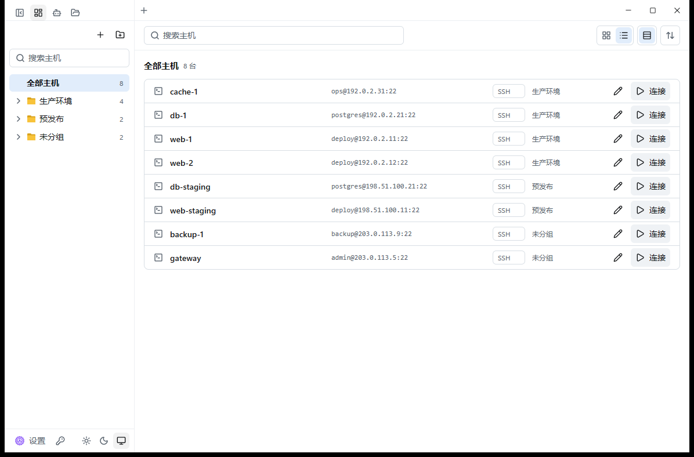

<p align="center">
  
</p>

<h1 align="center">ZeeTerm</h1>

<p align="center">
  <strong>Rust + GPUI 原生 SSH 工作区。</strong><br />
  将终端、文件传输、远端编辑与 AI 助手整合在一个桌面应用中。
</p>

<p align="center">
  
  
  
  
  <a href="LICENSE"></a>
</p>

<p align="center">
  <a href="https://github.com/MoeShinX/ZeeTerm/releases/latest"><strong>下载</strong></a> ·
  <a href="README.md">English</a> ·
  <a href="https://t.me/ZeeTerm">Telegram 群</a> ·
  <a href="https://zeeterm.app/">官网 · 筹备中</a> ·
  <a href="CHANGELOG.md">更新日志</a>
</p>

## ⚡ 从 Z-SSH 到 GPUI 原生重构

ZeeTerm 是 **[Z-SSH](https://github.com/MoeShinX/Z-SSH) 的 GPUI 原生重构版本**。桌面界面与终端绘制由 Rust 实现，GPUI 负责界面，Alacritty 终端引擎负责终端状态处理。

**不依赖 Electron，不依赖 WebView2，不使用内嵌浏览器绘制界面。** 桌面程序无需 Node.js 运行时。ZeeTerm 保留共用的 SSH、SFTP、存储与同步核心，将原有 Tauri + React 前端替换为 GPUI 原生绘制。

ZeeTerm 拥有独立的安装目录和数据目录，可以与 Z-SSH 同时安装、使用。



*截图使用虚拟连接数据。*

## 🧰 围绕远程工作组织功能

| 核心能力 | 可以做什么 |
| :--- | :--- |
| **终端工作区** | 多标签、分屏、标签拖出为独立窗口；可配置回滚行数，支持主题、终端配色和关键词高亮。 |
| **会话与认证** | 用会话树、分组和搜索管理连接；支持密码、SSH 私钥与 SSH Agent，提供代理、跳板机和端口转发。 |
| **SFTP 文件管理** | 浏览本地与远端文件，拖放传输，跟随终端目录，管理传输队列与断点续传。 |
| **远端编辑器** | 在标签中直接编辑远端文件，提供语法高亮、保存冲突检查与草稿恢复。 |
| **AI 运维助手** | 使用内置 **ZeePilot**，或接入已安装的 OpenCode、Codex、Claude Code；可选择逐条确认、只读自动或全部放行。 |
| **加密同步与备份** | 支持 WebDAV、S3 兼容存储、GitHub Gist、OneDrive；提供本地加密备份与额外云端备份目标。 |
| **服务器概览** | 在终端旁查看 CPU、内存、磁盘和网络信息。 |
| **应用锁定** | 手动锁定或空闲自动锁定工作区，会话与文件传输继续在后台运行。 |

除 SSH 外，也支持 **Telnet 与串口连接**。外部 AI 工具为可选集成，需要满足各自的安装、账号及运行环境要求。

## 开始使用

**当前支持：Windows 10 / 11（x64）和 Linux（x86_64）。**

### Windows

1. 从 [GitHub Releases](https://github.com/MoeShinX/ZeeTerm/releases/latest) 下载 `ZeeTerm-Setup-<版本>.exe`。
2. 运行安装程序，按当前用户安装，无需管理员权限。
3. 添加会话，选择认证方式并连接。首次连接 SSH 主机时，请核对服务器指纹。

数据默认保存在 `%APPDATA%\ZeeTerm`，也可以通过环境变量 `ZSSH_DATA_DIR` 指定其他目录。

### Linux

系统要求：x86_64，**glibc 2.35 及以上**（Ubuntu 22.04+、Debian 12+ 或同代发行版），Wayland 或 X11，以及 **Vulkan 驱动**（例如 `mesa-vulkan-drivers`，`.deb` 会推荐安装）。

- **Debian / Ubuntu（`.deb`）：** 从 [GitHub Releases](https://github.com/MoeShinX/ZeeTerm/releases/latest) 下载 `ZeeTerm-<版本>-linux-x86_64.deb`，执行 `sudo apt install ./ZeeTerm-<版本>-linux-x86_64.deb`；卸载用 `sudo apt remove zeeterm`。
- **其他发行版（`.tar.gz`）：** 下载 `ZeeTerm-<版本>-linux-x86_64.tar.gz`，解压后在目录里运行 `./install.sh`。默认装到 `~/.local`，不需要 root（`--prefix <目录>` 可改位置）；卸载运行 `~/.local/share/zeeterm/uninstall.sh`。也可以不安装，直接在解压目录里运行 `./zeeterm`。

两种包都会装上应用菜单项和图标（应用标识 `app.zeeterm.ZeeTerm`）。`zeeterm --version` 打印已安装的版本。`zssh-mcp` 必须和 `zeeterm` 放在同一个目录，两种包都已经这样放好。

数据默认保存在 `$XDG_DATA_HOME/ZeeTerm`（通常是 `~/.local/share/ZeeTerm`），目录权限仅限本人；`ZSSH_DATA_DIR` 仍然优先。保存的密码和密钥通过桌面钥匙串（Secret Service：GNOME Keyring、KeePassXC、KWallet 等）保护，建议安装并解锁其中一个。完全没有钥匙串服务时，密钥改存数据目录里的文件，设置页会提示。

**从 Z-SSH 迁移？** 使用应用内的导入流程，先预览数据并创建备份，再应用变更。

## 🔐 安全与数据管理

- **默认本地存储。** 会话和应用数据保存在本机，由你决定是否配置云同步或 AI 服务。
- **保存的凭据受保护。** 密码、托管私钥、私钥口令及同步秘密使用 Windows DPAPI 加密，绑定 Windows 用户环境；Linux 上用一把保存在桌面钥匙串（Secret Service）里的随机资料库密钥加密。
- **同步包加密。** 使用主密码配合 **Argon2id + XChaCha20-Poly1305**；更换电脑时，通过加密导出或同步迁移凭据。
- **SSH 主机指纹验证。** 连接未知主机或指纹发生变化时，先核对服务器身份。
- **更新先验签。** 更新器校验发布签名及签名中的版本号，再运行安装程序。

应用锁用于保护无人看守的工作区，不能替代操作系统安全防护。AI 服务会接收所启用操作需要的上下文，请按实际需要选择服务提供方与执行权限。

## 技术架构

| 层次 | 实现 |
| :--- | :--- |
| 桌面界面 | Rust · GPUI · GPUI Kit |
| 终端状态 | Alacritty 终端引擎 |
| SSH / SFTP | `russh` · `russh-sftp` |
| 异步运行时 | Tokio |
| 本地存储 | SQLite · Windows DPAPI · Linux Secret Service |
| 加密同步 | Argon2id · XChaCha20-Poly1305 |
| 安装与更新 | NSIS 安装包 · Linux `.deb` / `.tar.gz` · minisign 更新验签 |

仓库分为两个 Cargo 工作区：

- **`crates/`**：共用核心库、应用运行层、Windows 平台能力与 MCP 工具桥。
- **`native/`**：GPUI 应用、终端与会话组件、编辑器、高亮引擎、更新器及安装程序。

## 从源码构建

需要 **Windows 10/11 x64**、[rust-toolchain.toml](rust-toolchain.toml) 指定的 Rust MSVC 工具链，以及包含 Windows SDK 的 **Visual Studio 2022 C++ 生成工具**。打安装包还需要 [NSIS](https://nsis.sourceforge.io/)。SSH 使用 `ring` 后端，构建不需要 CMake 和 NASM。

```powershell
git clone https://github.com/MoeShinX/ZeeTerm.git
cd ZeeTerm

# 编译原生应用
cargo build --manifest-path native/Cargo.toml --release --locked

# 运行格式、静态检查、测试及 gate 配置检查
powershell -File scripts/gates.ps1

# 构建 Windows 安装包（PowerShell 7）
pwsh -File native/installer/build.ps1
```

应用产物位于 `native/target/release/zssh-gpui.exe`，安装包位于 `native/installer/out/`。

**Linux：** 用 `scripts/linux-build-deps.sh` 装系统依赖（清单就在这个脚本里，CI 也用它），再装 [rust-toolchain.toml](rust-toolchain.toml) 指定的 Rust 工具链，然后：

```bash
git clone https://github.com/MoeShinX/ZeeTerm.git
cd ZeeTerm

# 编译原生应用
cargo build --manifest-path native/Cargo.toml --release --locked

# 格式、静态检查、测试（在一次性的 D-Bus 会话 + 临时解锁的钥匙串里跑）及 gate 配置检查
scripts/gates.sh

# 打 .deb 和 .tar.gz，产物在 dist/<版本>/
scripts/package-linux.sh
```

应用产物位于 `native/target/release/zssh-gpui`。发布用的包要在 Ubuntu 22.04 上编，保证 glibc 2.35 基线，详见 [docs/RELEASING.md](docs/RELEASING.md)。

开发约定与独立测试数据要求见 [AGENTS.md](AGENTS.md)，发布及签名流程见 [docs/RELEASING.md](docs/RELEASING.md)。

## 💬 社区与项目入口

- **[Telegram · ZeeTerm 交流群](https://t.me/ZeeTerm)**：使用交流、问题反馈与建议。
- **[zeeterm.app 官网](https://zeeterm.app/)**：目前筹备中，后续开发。现阶段请通过 GitHub 下载程序和查看项目文档。
- **[GitHub Issues](https://github.com/MoeShinX/ZeeTerm/issues)**：提交问题或功能建议，请附上应用版本、复现步骤，以及已脱敏的截图或日志。
- **[更新日志](CHANGELOG.md)**：查看版本历史与近期变化。

## 许可与致谢

ZeeTerm 以 **[GPL-3.0-or-later](LICENSE)** 开源。第三方组件、移植代码的来源与致谢见 [NOTICE](NOTICE) 和 [native/NOTICE](native/NOTICE)。
